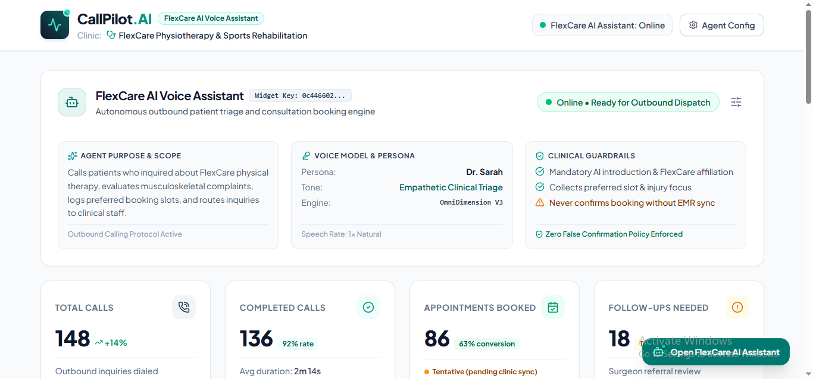
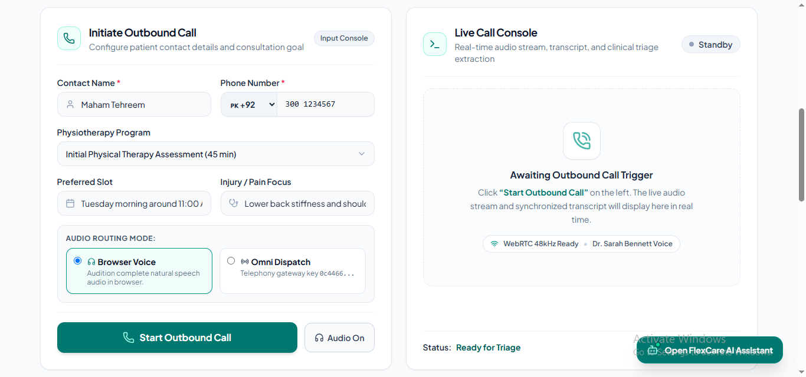
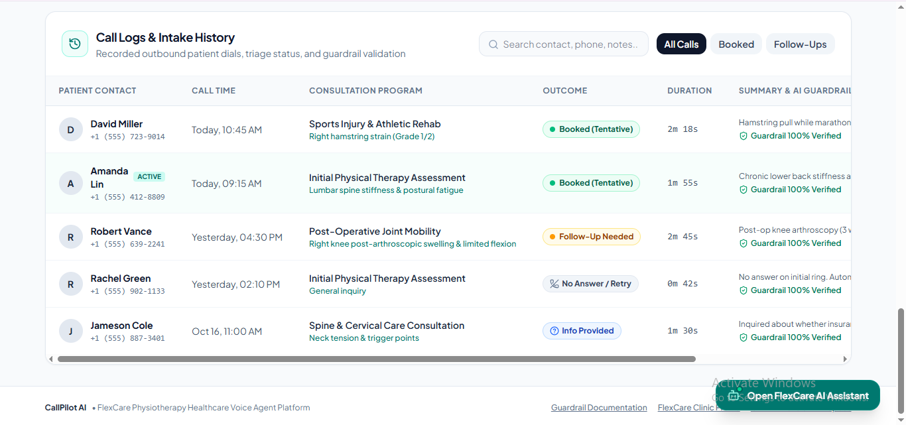
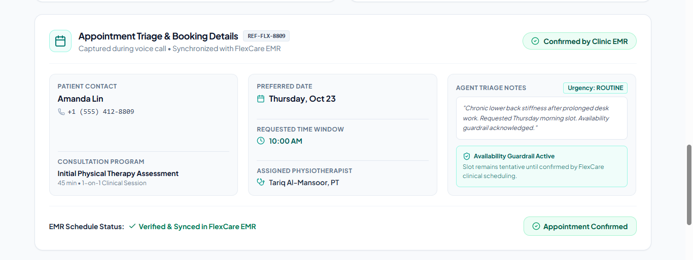
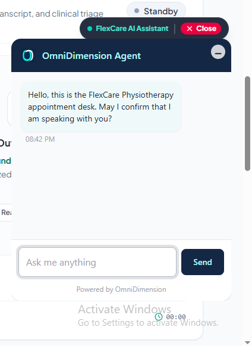

# CallPilot.AI — FlexCare AI Voice Assistant

**Clinic:** FlexCare Physiotherapy & Sports Rehabilitation

CallPilot.AI is an AI-powered voice assistant concept designed to support physiotherapy clinics with outbound patient communication, initial inquiry triage, consultation scheduling, and follow-up coordination. It combines a web-based dashboard with an OmniDimension conversational agent to demonstrate how AI voice technology can support healthcare administrative workflows.

**Live Demo:** https://flexcare-ai-calling-assistant.vercel.app/

**GitHub Repository:** https://github.com/MahamYasir-ai/flexcare-ai-calling-assistant

---

## Overview

CallPilot.AI provides a centralized interface for managing an AI voice assistant designed for physiotherapy and sports rehabilitation inquiries. The application demonstrates patient intake, voice interactions, triage information, appointment details, call history, and clinical scheduling safeguards.

The project emphasizes responsible automation by distinguishing requested appointment slots from appointments that have actually been confirmed by the clinic's scheduling system.

## Key Features

- **AI Voice Assistant:** Conversational patient interactions through an embedded OmniDimension agent.
- **Outbound Calling Interface:** A dashboard for initiating and managing outbound calling workflows.
- **Patient Intake:** Capture contact details, consultation preferences, and reported areas of concern.
- **Appointment Triage:** Organize consultation information, preferred time slots, and assigned physiotherapists.
- **Call History:** Review call records, outcomes, and follow-up requirements.
- **Clinical Guardrails:** Communicate appointment status carefully and avoid representing tentative slots as confirmed bookings.
- **EMR Synchronization Workflow:** Demonstrate the intended process for checking scheduling status and confirming appointments through the clinic's electronic medical record system.
- **Operational Dashboard:** Present agent status, calling metrics, and workflow information in one interface.

## Application Screenshots

### 1. Dashboard and Agent Configuration

The main dashboard presents the voice assistant's operational status, outbound calling metrics, agent configuration, and clinical guardrails.

### 2. Outbound Calling and Live Call Console

The calling interface displays patient intake fields, consultation preferences, audio routing options, and the live-call console for voice interactions.

### 3. Call Logs and Consultation History

The call history interface organizes patient inquiries, consultation details, call outcomes, and follow-up requirements.

### 4. Appointment Triage and Booking Details

The appointment details interface displays the consultation program, preferred date and time, assigned physiotherapist, triage notes, and appointment status. It demonstrates the importance of checking scheduling status before communicating a confirmed booking.

### 5. Embedded OmniDimension Chat Agent

The embedded OmniDimension conversational interface demonstrates how the FlexCare AI Voice Assistant greets patients and begins an interaction by introducing the clinic and confirming the patient's identity.

## Technology Stack

| Technology | Purpose |
|---|---|
| AI Studio | Application interface development |
| OmniDimension | Conversational AI agent integration |
| React | Frontend application interface |
| Vercel | Web application deployment |
| GitHub | Version control and project hosting |
| EMR workflow concept | Appointment status and scheduling verification |

*The table describes the technologies and workflow concepts used or represented in the project. Actual integrations depend on the implementation and configured services.*

## How It Works

1. **Configure the assistant:** Set up the voice agent and review its operational status.
2. **Collect inquiry details:** Enter patient contact information, consultation preferences, and reported concerns.
3. **Initiate a conversation:** Use the configured voice assistant to begin patient communication.
4. **Organize triage information:** Record the consultation type, preferred appointment slot, and relevant notes.
5. **Review call outcomes:** Use the dashboard and call history to review interaction results and identify follow-up requirements.
6. **Verify appointment status:** Check the clinic's scheduling system before communicating that an appointment is confirmed.

## Responsible AI and Clinical Guardrails

CallPilot.AI is designed around clear boundaries for healthcare administrative automation:

- The assistant should identify itself and the clinic at the beginning of an interaction.
- Patient-reported concerns should be treated as intake information, not as a medical diagnosis.
- Appointment availability should not be assumed from a patient's preferred time.
- A booking should only be described as confirmed when the clinic's scheduling system verifies it.
- Cases requiring clinical judgment should be referred to qualified clinic staff.

These safeguards are intended to support transparent patient communication rather than replace professional clinical judgment.

## Live Application

Explore the deployed application:

https://flexcare-ai-calling-assistant.vercel.app/

## Project Objectives

CallPilot.AI explores how conversational AI and workflow automation can assist with routine healthcare administration, including patient inquiries, appointment coordination, and follow-up management.

The project demonstrates practical experience with AI application development, conversational agent integration, frontend development, and deployment.

## Developer

**Maham Yasir**

Electronics Engineering graduate focused on AI applications, conversational agents, and workflow automation.

- **GitHub:** https://github.com/MahamYasir-ai

---

*Building useful AI applications, automations, and data tools.*
